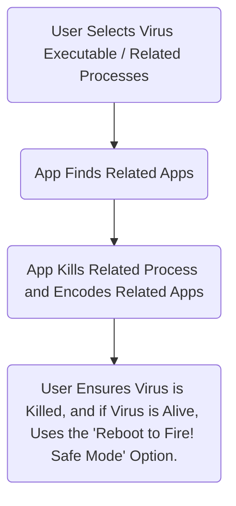

# Fire!
Time to Say Goodbye, Naughty Virus!
> [!NOTE]
> Project Under Build but Check Here Back Soon!
# How Does it work?

1. User Selects Virus Executable / Related Processes
2. App Finds Related Apps
3. App Kills Related Process and Encodes Related Apps
4. User Ensures Virus is Killed, and if Virus is Alive, Uses the 'Reboot to Fire! Safe Mode' Option.
# Why it is Better than **AV**\*s?
An Antivirus Must **Check Everything Running** and **Separate Helpful app And Viruses**,  
But Fire! is **100% True Positive** Because the User Decides What is The Virus  
(\***AV** Stands For **Antivirus**)
# This Program is Useful When
1. An App Corrupted Task Manager, And
### Note!
This is A Small Project And **it must Remain Small to Remain Useful**,  
Because **Viruses Can Corrupt the Program When Running**!  
#001  
(This issue Will Be Fixed Soon)
